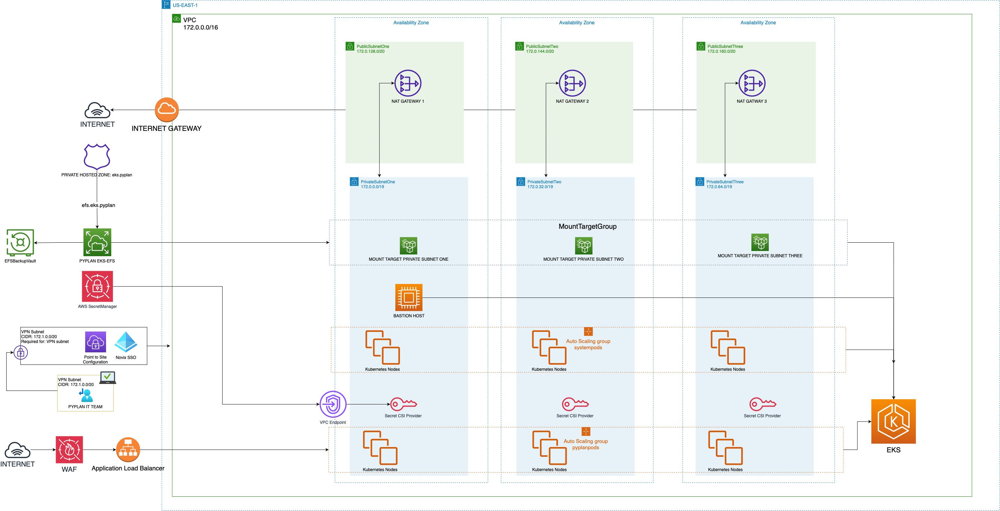

# AWS (Amazon EKS)

Pyplan runs on Amazon Elastic Kubernetes Service in a private cluster spread across three Availability Zones. The infrastructure is defined with AWS CloudFormation, and the application is deployed with a Helm chart synchronized by Argo CD.

## Reference architecture

## Requirements

On top of the [common requirements](./deployments-summary#common-requirements):

### Network

- VPC with 3 public and 3 private subnets in different Availability Zones. A `/16` (65,536 addresses) is enough.
- DNS hostnames and DNS resolution enabled.
- One NAT gateway per public subnet, and route tables that send the private subnets' Internet traffic through them.
- Subnet tags for Karpenter: `kubernetes.io/role/internal-elb: 1` and `karpenter.sh/discovery: [CLUSTER_NAME]`.
- Private hosted zone in Route 53 for the EFS and RDS endpoints *(optional)*.

### EKS cluster

- Private API endpoint; worker nodes only in the private subnets.
- EKS add-ons: EKS Pod Identity, EFS CSI driver, EBS CSI driver, Secrets Store CSI provider, VPC CNI, kube-proxy, CoreDNS and Metrics Server.
- **Karpenter** for node autoscaling, and the **AWS Load Balancer Controller** for the ingress.

### Node groups

| Node group | Instance type | Nodes | Label | Runs |
|---|---|---|---|---|
| Application | `c7g.xlarge` (4 vCPU / 8 GB, Graviton) | 2 – 4 | `env: Pyplan` | Pyplan application pods |
| Engines | Provisioned by Karpenter | 0 – on demand | `env: PyplanArmEngines` | Calculation engines |

- Amazon Linux 2023 (Arm) on both.

### Database: Amazon RDS for PostgreSQL

- PostgreSQL 16, Multi-AZ, `db.t3.small` as the minimum instance class, 20 GB of storage.
- Parameter group with `max_connections: 1000`.
- No public access; security group that only allows port 5432 from the cluster security group.
- Automated backups with 30 days of retention, and encryption at rest.

### Storage: Amazon EFS

- EFS Standard (Multi-AZ), General Purpose performance mode, encryption at rest.
- One mount target per private subnet; security group that only allows port 2049 (NFS) from the cluster security group.
- Daily backup with AWS Backup.

### Ingress, TLS and secrets

- Application Load Balancer (internet-facing or internal) created by the AWS Load Balancer Controller, with the TLS certificate in **AWS Certificate Manager** and an **AWS WAF** web ACL.
- Application secrets in **AWS Secrets Manager**, read by the pods through the Secrets Store CSI driver and EKS Pod Identity.
- Container images in a private **Amazon ECR** repository *(recommended)*.

### Administrative access

- CI/CD pipeline authenticated with OIDC, with separate roles for the infrastructure and for the cluster configuration.
- Bastion host *(optional)*: a private instance without inbound ports, reached through AWS Systems Manager. If the customer already has CI/CD or an equivalent secure access path, Pyplan adapts to it.

## Related articles

- [Deployments and Requirements: Summary](./deployments-summary)
