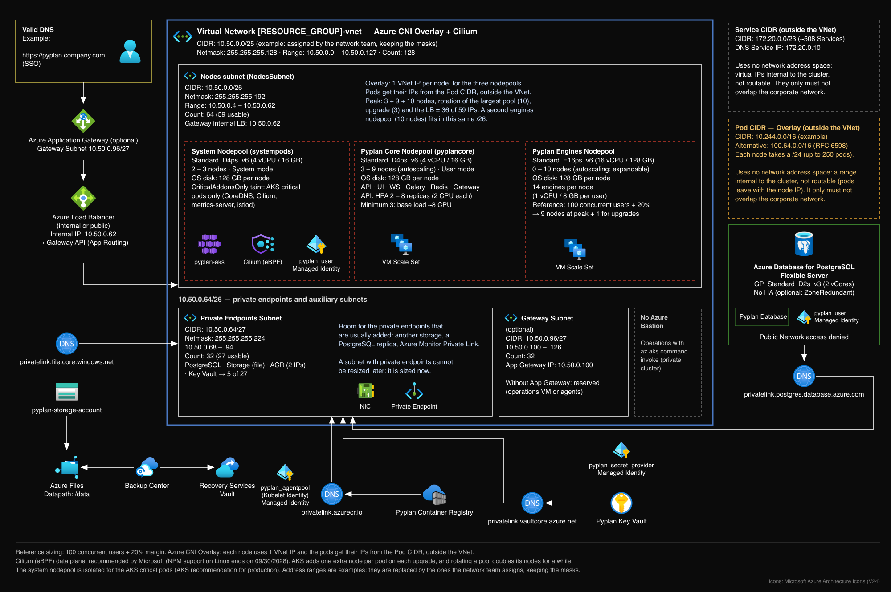

# Azure (Azure Kubernetes Service)

Pyplan runs on a private Azure Kubernetes Service cluster with Azure CNI Overlay and the Cilium data plane. Every data service is reached through a private endpoint, and the services authenticate with managed identities. The infrastructure is defined with Terraform, and the application is deployed with a Helm chart synchronized by Argo CD.

## Reference architecture

## Requirements

On top of the [common requirements](./deployments-summary#common-requirements):

### Network

**Azure CNI Overlay with the Cilium data plane.** The VNet only provides one address per node and per private endpoint; pods get their addresses from a Pod CIDR outside the VNet, so a `/25` VNet is enough.

| Subnet | Example CIDR | Purpose |
|---|---|---|
| Cluster VNet | `10.50.0.0/25` | Address space of the cluster and its private services |
| Nodes | `10.50.0.0/26` | Nodes of the three node pools and the internal load balancer IP |
| Private endpoints | `10.50.0.64/27` | PostgreSQL, Storage Account, Container Registry and Key Vault |
| Gateway *(optional)* | `10.50.0.96/27` | Azure Application Gateway, if the design requires one |
| Pod CIDR (outside the VNet) | `10.244.0.0/16` | Pod addresses; not routed, but must not overlap the corporate network |
| Service CIDR (outside the VNet) | `172.20.0.0/23` | Kubernetes Service addresses; must not overlap the corporate network |

### AKS cluster

- Private cluster, Standard tier, with Microsoft Entra ID integration and Azure RBAC (no local accounts).
- AKS application routing add-on with **Gateway API** enabled: an Istio-based gateway for ingress only, with no service mesh.

### Node pools

Each node has a 128 GB OS disk.

| Node pool | VM size | Nodes | Label / taint | Runs |
|---|---|---|---|---|
| System | `Standard_D4ps_v6` (4 vCPU / 16 GB) | 2 – 3 | taint `CriticalAddonsOnly` | AKS critical pods only |
| Pyplan Core | `Standard_D4ps_v6` (4 vCPU / 16 GB) | 3 – 9 | `env: Pyplan` | Pyplan application pods |
| Engines | `Standard_E16ps_v6` (16 vCPU / 128 GB) | 0 – 10 | `env: PyplanEngines` | Calculation engines |

With engines of 1 vCPU / 8 GB, a `Standard_E16ps_v6` holds 14 sessions: engine nodes at peak = concurrent users × 1.2 / 14, rounded up (100 concurrent users → 9 nodes).

### Database: Azure Database for PostgreSQL Flexible Server

- PostgreSQL 16, General Purpose, `GP_Standard_D2s_v3` (2 vCores, 8 GB RAM) and 32 GB of storage as the minimum.
- Automated backups with point-in-time restore, 30 days of retention, geo-redundant. Zone-redundant high availability *(optional)*.
- Authentication with Microsoft Entra ID (managed identity) and password. Public network access denied; access through a private endpoint.
- `max_connections: 1000` and all the PostgreSQL extensions enabled.

### Storage: Azure Files Premium

- Premium storage account (FileStorage, `Premium_LRS`) with a file share of at least 100 GB, accessed through a private endpoint.
- Daily backup with Azure Backup, 30 days of retention.
- Pyplan grows the share by 20% when it passes 80% of its size, up to a configurable limit.

### Security and images

- **Azure Key Vault** (RBAC authorization, private endpoint) for the application secrets and the TLS certificate, read by the pods through the Secrets Store CSI driver with a managed identity.
- **Azure Container Registry** with a private endpoint: the images are imported into it and the nodes pull them with the kubelet managed identity.
- **Managed identities** for Key Vault, Container Registry and PostgreSQL: no passwords or API keys between services.

### Access and Internet

- CI/CD pipeline authenticated with workload identity federation (recommended); people access the cluster with their Microsoft Entra ID account. No bastion machine: ad-hoc operations use `az aks command invoke`.
- Permanent outbound access to the destinations AKS requires to operate (Microsoft's *Outbound network and FQDN rules for AKS clusters*); it can go through the corporate firewall.

## Related articles

- [Deployments and Requirements: Summary](./deployments-summary)
