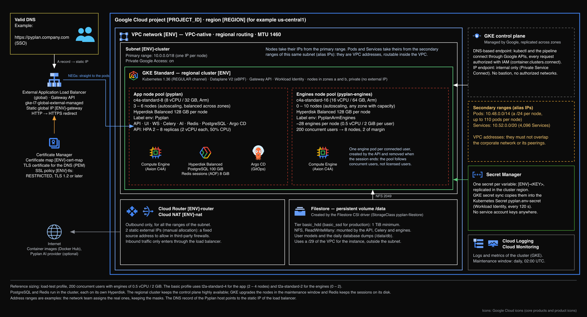

# Google Cloud (Google Kubernetes Engine)

Pyplan runs on a regional Google Kubernetes Engine cluster with private nodes and GKE Dataplane V2. Users come in through a global external Application Load Balancer created by the GKE Gateway controller, and the secrets reach the cluster from Secret Manager through Workload Identity. The infrastructure is defined with Terraform, and the application is deployed with a Helm chart synchronized by Argo CD.

## Reference architecture

## Requirements

On top of the [common requirements](./deployments-summary#common-requirements):

### Network

VPC-native networking: one subnet for the nodes, with two secondary ranges for the pods and the Services. Pod and Service addresses are VPC addresses, so they must not overlap the corporate network or its peerings.

| Range | Example CIDR | Purpose |
|---|---|---|
| Cluster subnet (primary) | `10.0.0.0/18` | One address per node; Private Google Access enabled |
| Pods (secondary) | `10.48.0.0/14` | A `/24` per node, up to 110 pods per node |
| Services (secondary) | `10.52.0.0/20` | Kubernetes Service addresses |

- Cloud Router and Cloud NAT for outbound traffic, with static external IPs to allowlist in third-party firewalls.
- The control plane needs no range of its own: it connects through Private Service Connect.

### GKE cluster

- GKE Standard, **regional** cluster, Kubernetes `1.36` on the REGULAR release channel, nodes in two zones.
- **GKE Dataplane V2** (eBPF), which enforces the NetworkPolicies. It can only be selected when the cluster is created.
- Private nodes (no external IPs). Control plane access through the **DNS-based endpoint**, authorized with IAM (`container.clusters.connect`) and recorded in Cloud Audit Logs: no bastion VM and no authorized networks.
- Add-ons: HTTP Load Balancing, Gateway API (Standard channel), Horizontal Pod Autoscaling, Filestore CSI driver, Workload Identity and Secret Manager secret sync.

### Node pools

Two node pools on Arm (C4A, Google Axion), each with a 128 GB Hyperdisk Balanced boot disk per node (C4A only supports Hyperdisk). Sizing for 200 concurrent users with engines of 0.5 vCPU / 2 GiB:

| Node pool | Machine type | Nodes | Label | Runs |
|---|---|---|---|---|
| `pyplan` | `c4a-standard-8` (8 vCPU / 32 GB) | 3 – 6 | `env: Pyplan` | Application pods, Redis, PostgreSQL, Argo CD |
| `pyplan-engines` | `c4a-standard-16` (16 vCPU / 64 GB) | 0 – 10 | `env: PyplanArmEngines` | Calculation engines (about 28 per node) |

Regional quota for this sizing: about 232 C4A vCPUs and 2.4 TB of Hyperdisk Balanced, counting one upgrade node per pool.

### Database: PostgreSQL

- By default PostgreSQL 16 runs in the cluster, with reserved resources (4 vCPU / 16 GiB) and its own 100 GiB Hyperdisk.
- **Cloud SQL for PostgreSQL** is also supported: 4 vCPUs / 15 GB recommended, SSD storage, high availability and point-in-time recovery for production, private IP only.

### Storage: Filestore

- Created dynamically by the Filestore CSI driver (StorageClass `pyplan-filestore`) in the cluster's VPC.
- Tier `basic_hdd` (`basic_ssd` for production), 1 TB minimum, ReadWriteMany.
- NFS (port 2049) allowed from the GKE nodes. Daily backup of the instance.

### Ingress, TLS and secrets

- **GKE Gateway controller** (`gke-l7-global-external-managed`): a global external Application Load Balancer with container-native load balancing to the pods, on a reserved static IP address.
- The TLS certificate in **Certificate Manager**, and an SSL policy with the `RESTRICTED` profile and TLS 1.2 as the minimum version.
- Application secrets in **Secret Manager**, copied into the cluster by GKE secret sync with Workload Identity.

### Administrative access

- CI/CD pipeline authenticated with Workload Identity Federation (no service account keys), impersonating a service account with only the GKE, network, Certificate Manager and Secret Manager roles it needs.

## Related articles

- [Deployments and Requirements: Summary](./deployments-summary)
