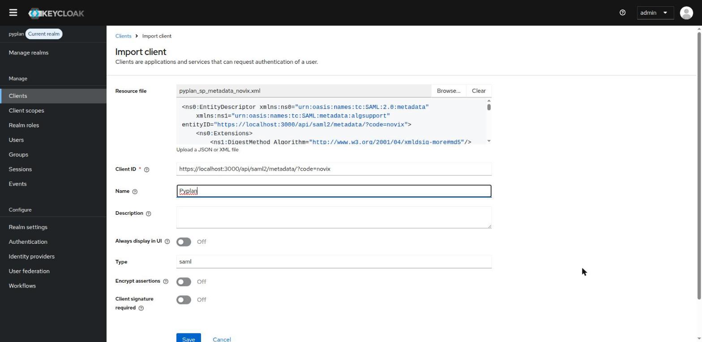
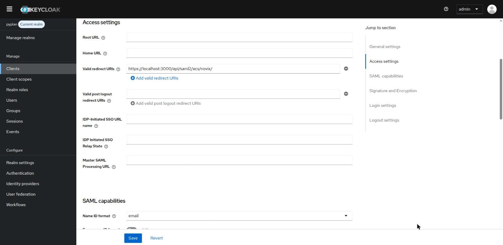
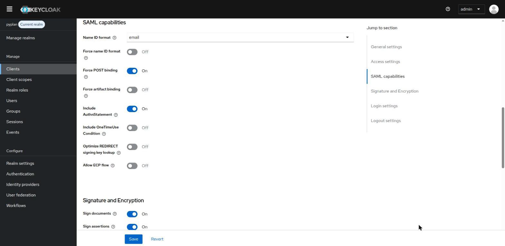
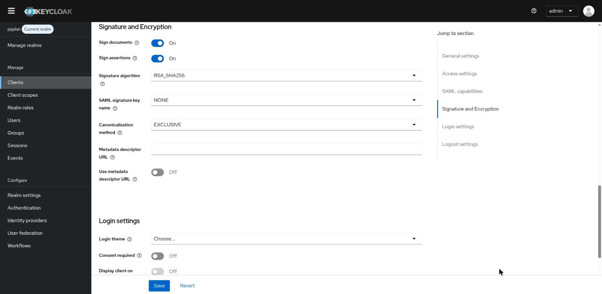
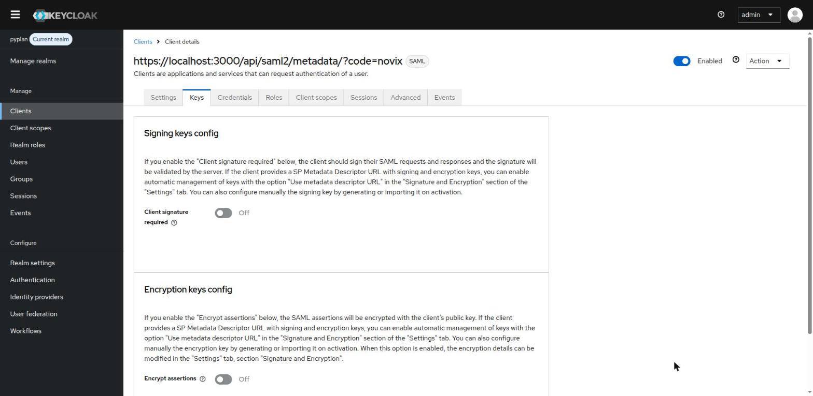
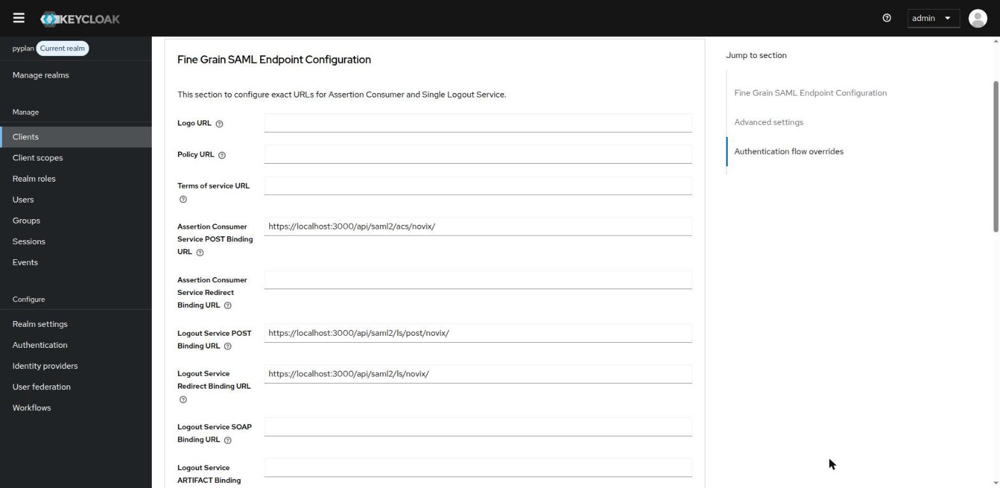
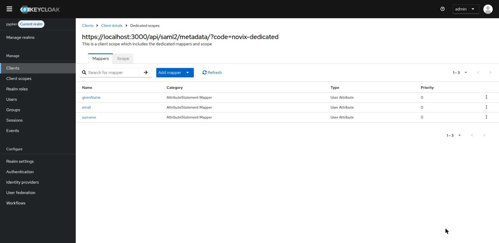
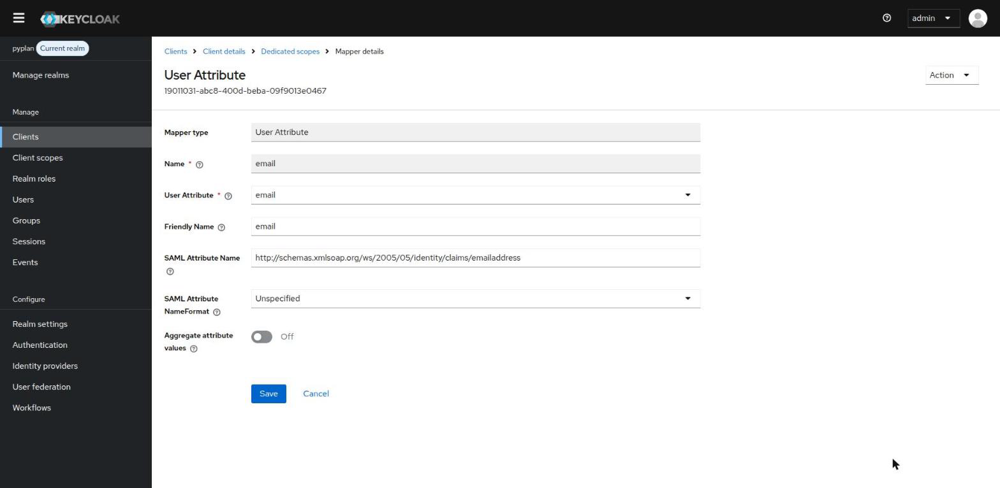
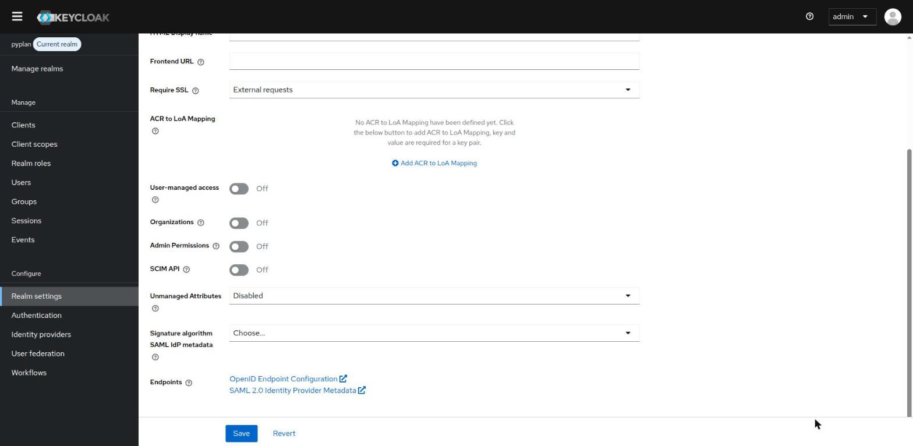
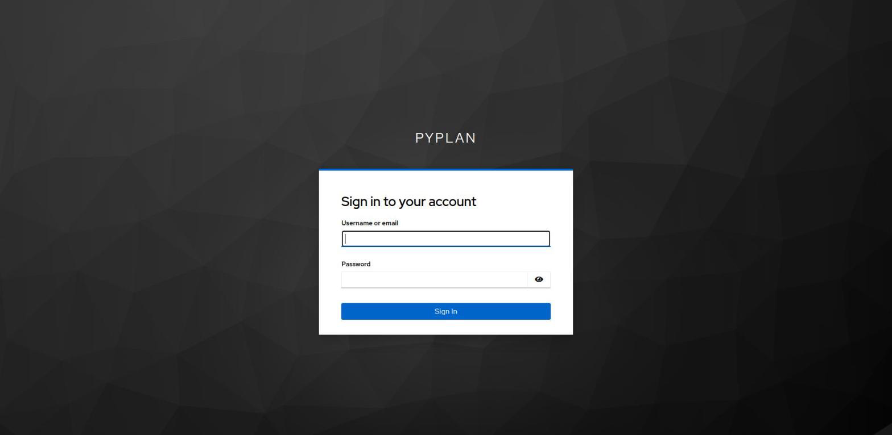

# Keycloak

# Requirements

To integrate Pyplan with Keycloak it will be necessary to create a **SAML client** in the Keycloak realm that your users sign in to.

Keycloak rejects return URLs whose query string contains a reserved OAuth/OIDC parameter, such as `code`. For this reason, Keycloak integrations use URLs that carry the Pyplan company code **in the path** instead of in the `?code=` query parameter used by other identity providers:

| Field | Value |
|---|---|
| **Client ID (Entity ID)** | `https://[DNS_CLUSTER_INGRESS]/api/saml2/metadata/?code=[COMPANY_NAME]` |
| **Assertion Consumer Service (POST)** | `https://[DNS_CLUSTER_INGRESS]/api/saml2/acs/[COMPANY_NAME]/` |
| **Logout Service (POST)** | `https://[DNS_CLUSTER_INGRESS]/api/saml2/ls/post/[COMPANY_NAME]/` |
| **Logout Service (Redirect)** | `https://[DNS_CLUSTER_INGRESS]/api/saml2/ls/[COMPANY_NAME]/` |

The Client ID keeps the `?code=` form: Keycloak doesn't treat it as a return URL.

:::info
Pyplan must configure your company with these same URLs. Let the Pyplan team know that your identity provider is Keycloak when you start the integration.
:::

# Instructions

## Download the Pyplan Metadata File

Download the service provider metadata for your company from:

```
https://[DNS_CLUSTER_INGRESS]/api/saml2/metadata_generator?company=[COMPANY_NAME]&url_style=path
```

:::warning
Keep the `url_style=path` parameter. Without it, the file contains the `?code=` URLs that Keycloak rejects.
:::

## Import the Client

In the Keycloak admin console, select your realm and go to **Clients → Import client**. Upload the metadata file as the **Resource file**: Keycloak fills in the **Client ID** from it. Optionally, enter `Pyplan` as the **Name**.

Leave **Client signature required** turned off and click **Save**.



## Review the Client Settings

The import configures the client from the metadata file. Check that the following values are set in the **Settings** tab.

**Access settings**: **Valid redirect URIs** contains the Assertion Consumer Service URL, with the company code in the path.



**SAML capabilities**: **Name ID format** is `email` and **Force POST binding** is on.



**Signature and Encryption**: **Sign assertions** is on.



:::info
The **Sign assertions** setting is mandatory.
:::

In the **Keys** tab, **Client signature required** is off. Pyplan doesn't sign its authentication requests.



In the **Advanced** tab, under **Fine Grain SAML Endpoint Configuration**, the Assertion Consumer Service and Logout Service URLs match the ones in the table at the beginning of this page.



## Configure the Attribute Mappers

Go to the **Client scopes** tab of the client and open the dedicated scope (`[CLIENT_ID]-dedicated`). The import creates one mapper for each attribute that Pyplan requests: `email`, `givenName` and `surname`.



Open each mapper and set the following values:

| Mapper | User Attribute | SAML Attribute Name | SAML Attribute NameFormat |
|---|---|---|---|
| **email** | `email` | `http://schemas.xmlsoap.org/ws/2005/05/identity/claims/emailaddress` | `Unspecified` |
| **givenName** | `firstName` | `http://schemas.xmlsoap.org/ws/2005/05/identity/claims/givenname` | `Unspecified` |
| **surname** | `lastName` | `http://schemas.xmlsoap.org/ws/2005/05/identity/claims/surname` | `Unspecified` |



*Example: email mapper*

:::info
These are the attribute names of Pyplan's default attribute map. If your company uses a custom attribute map, use the names agreed with the Pyplan team instead.
:::

## Send the Identity Provider Metadata to Pyplan

Go to **Realm settings → General → Endpoints** and copy the **SAML 2.0 Identity Provider Metadata** link. Send that URL, or the XML file it returns, to the Pyplan team.

```
https://[KEYCLOAK_HOST]/realms/[REALM]/protocol/saml/descriptor
```



## Test the Sign-in

Once Pyplan has configured your company, open `https://[DNS_CLUSTER_INGRESS]/saml/[COMPANY_NAME]`. Pyplan redirects you to the Keycloak sign-in page of your realm and, after you sign in, back to Pyplan.



# Troubleshooting

**Keycloak shows "Invalid redirect uri"** and its log contains `Redirect URI rejected: contains forbidden OIDC parameter 'code'`: the URLs still use `?code=`. Check that the metadata file was downloaded with `url_style=path` and that Pyplan configured your company with the path URLs.

**Keycloak shows "Invalid redirect uri" without that log message**: the Assertion Consumer Service URL in **Valid redirect URIs** doesn't match the one Pyplan sends. Check the host, the company code and the trailing `/`.
