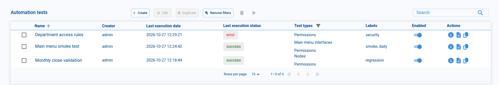
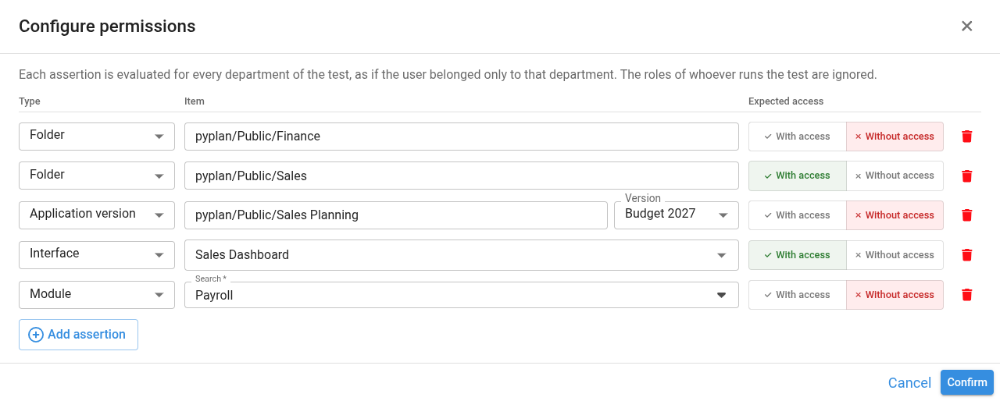
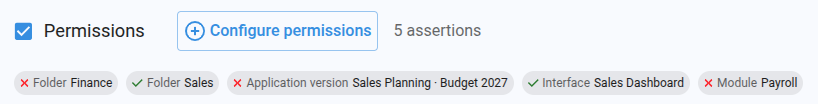
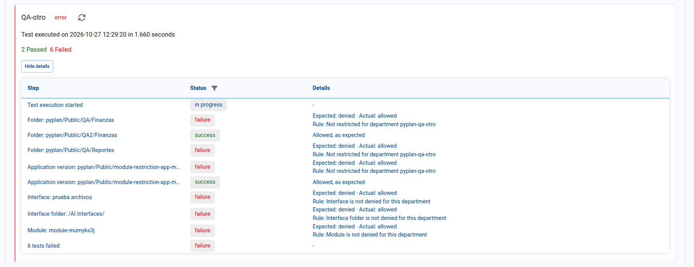

# Automation Tests

This section in Pyplan lets us automatically validate that our applications, interfaces, and nodes behave as expected, and that each department has access only to the folders, applications, interfaces, and modules it should.

It can be accessed from the main menu of the application, within the **App management** submenu.

## Automation Test Manager

The **Automation Test Manager** is the main screen where all automation tests defined in a Pyplan application are listed and controlled.



From this view we can:

- Create, edit, and duplicate tests.
- See key information: **Name**, **Creator**, **Last execution date**, **Last execution status**, **Test types**, **Labels**, and whether the test is **Enabled**.
- Search tests by name with the **Search** box, and sort the list by **Name**, **Creator**, or **Last execution date** by clicking the column header.
- Filter the list by test type using the filter icon in the **Test types** column header. The available types are **Interfaces**, **Nodes**, **Main menu interfaces**, and **Permissions**. **Remove filters** clears the type filter.
- Use **Actions** on each row: view preconditions (read-only), open execution logs, or copy the test ID (useful for [pp.execute_tests](#ppexecute_tests-function)).

The toolbar actions depend on the selection: **Edit** and **Duplicate** become active when exactly one test is selected, while **Delete** and **Run** work with one or more selected tests.

## Create a Test

On the Automation Tests page, we click **Create** to open the **Create Automation Test** form.

### Parameters

| Parameter | Description |
|---|---|
| **Name** | The display name of the automation test. |
| **Labels** | Optional tags to group and search automation tests. |
| **Enabled** | A checkbox that controls whether the test is active. |
| **Departments** | Dropdown list to associate the test with one or more departments. The test runs once for each selected department. If no department is selected, it runs with the company's default department. |
| **Description** | A free-text field to describe what the test does and what success means. |
| **Notification mode** | Defines if and when notifications are sent: **Always send emails**, **Send emails only on failure**, or **No notification**. |
| **Users to notify** | Select the email recipients for test notifications. |
| **Interfaces** | When checked, links the test to one or more specific interfaces, including HTML interfaces (see [What an interface check validates](#what-an-interface-check-validates)). |
| **Main Menu Interfaces** | Targets high-level interfaces that appear in the main menu. |
| **Nodes** | When checked, associates the test with specific model nodes. |
| **Permissions** | When checked, enables the **Configure permissions** button to define access assertions for folders, applications, versions, interfaces, interface folders, and modules (see [Configuring Permissions](#configuring-permissions)). |

#### What an interface check validates

When a test includes interfaces (either selected individually or through **Main Menu Interfaces**), Pyplan opens each interface's definition and checks it without rendering it on screen. The check depends on the kind of interface:

- **Standard interfaces**: every component linked to a node is evaluated, and the check fails if the node does not exist or returns an evaluation error. Nodes used by the **Filter** component are evaluated as well, while **button** nodes are skipped. An interface without components also fails.
- **Dynamic HTML components**: besides the component's data node, Pyplan evaluates the nodes used by its actions and verifies that the interfaces targeted by **Open interface** actions still exist.
- **HTML interfaces**: Pyplan recompiles the interface's Python handler to detect syntax or structural errors, and checks its callbacks for references to names that are not defined.

:::warning
To detect undefined names in HTML interfaces, the callbacks that do not require parameters are invoked during the check. We should keep this in mind if any of those callbacks writes data or triggers external processes.
:::

#### Configuring Nodes

We click **Configure nodes** to open a dialog, and then click **+** next to the Nodes title to open the **Add node** window.

In the Add node window:
- Navigate the influence diagram to locate the node to validate.
- Click once on the node to select it.
- The node identifier appears at the bottom as **Selected node id**.
- Click **Confirm**.

Available check types for each node:

| Check type | Description |
|---|---|
| **No evaluation error** | Verify that the node evaluates without errors. |
| **Equal to** | Verify that the node's result equals a specific expected value. |
| **Between** | Verify that the node's result stays within a defined numeric range. |

After finishing node configuration, we click **Confirm** in the Nodes dialog.

#### Configuring Permissions

A **permissions test** verifies that the access rules configured for each department (see [Grant/Deny Access to Information](/user-guide/security-options#grantdeny-access-to-information)) produce the expected result. Each rule we want to verify is defined as an **assertion**: an item and the access we expect the department to have to it.

To configure the assertions:

1. Check the **Permissions** option in the test form.
2. Click **Configure permissions** to open the **Configure permissions** dialog.
3. For each assertion, choose the **Type** of item, select the **Item**, and set the **Expected access** to **With access** or **Without access**.
4. Click **Add assertion** to add another row, or use the trash icon to remove one.
5. Click **Confirm** to save the assertions.



The available item types are:

| Type | How the item is selected |
|---|---|
| **Folder** | A folder chosen from the File Manager tree. |
| **Application** | An application chosen from the File Manager tree. |
| **Application version** | An application chosen from the File Manager tree, plus one of its versions from the **Version** selector. |
| **Interface** | An interface of the current application, chosen from a searchable list. |
| **Interface folder** | A folder of the current application's interface manager, chosen from a searchable list (for example, `/Sales/Reports/`). |
| **Module** | A module node of the current application, found with the node search. |

Rows without an item selected (or, for application versions, without a version) are discarded when we confirm the dialog.

Once confirmed, the test form shows the number of assertions and a chip for each one, with a check mark for **With access** and a cross for **Without access**.



:::info How assertions are evaluated
Each assertion is evaluated for every department of the test, **as if the user belonged only to that department**. The roles of whoever runs the test are ignored, so the result depends exclusively on the department's access rules. If the test has no departments selected, the company's default department is used.
:::

An assertion passes when the actual access matches the expected one. It always fails, regardless of the expected access, when the item cannot be evaluated — for example, when the folder, application, version, interface, or module no longer exists, or when a path does not belong to the current company.

#### Preconditions

Preconditions define the conditions that must be met before the test runs. They typically use selector nodes from the application.

To add a precondition:
1. Open the **Search** dropdown.
2. Select the selector node to constrain.
3. In **Selector values**, specify the required value or list of values.

We use **Add precondition** only when we want to create a separate precondition (a new selector node with its own values).

After configuring all desired options, we click **Create** to save the automation test.

## Edit a Test

The **Edit test** screen lets us modify an existing automation test using the same fields as the Create screen. We click **Update** to save the new configuration, or **Cancel** to discard changes.

## Duplicate a Test

In the Automation Test Manager, we select a test and click **Duplicate**. In the dialog, we enter a new name for the duplicated test and click **Confirm**.

## Delete a Test

We select one or more tests, click **Delete**, and confirm in the dialog. Selected tests are permanently removed.

## Run a Test

We select one or more tests, click **Run**, and confirm in the dialog. Selected tests are added to the application's execution queue, and each test runs once per department. Once executed, results can be reviewed in the Logs view.

:::note
Tests are not executed immediately when we click Run — they are added to the execution queue.
:::

:::info Permission assertions need the execution queue
Permission assertions are evaluated per department, so they only run when the test goes through the execution queue: the **Run** button, the [Test Applications](/user-guide/tools/test-applications) tool, or `pp.execute_tests` with `detached_run=True`. When a test runs inside the current session (`pp.execute_tests` with `detached_run=False`), its permission assertions are skipped with a warning and do not make the test fail.
:::

## Test Execution Logs

The **Test execution logs** view lets us inspect what happened during the last run of an automation test.

We access the logs from the Automation Test Manager by clicking the logs icon in the **Actions** column.

**Execution Logs Page overview:**

- The header shows the test name and icons to edit or re-run the test.
- Below, one card per department shows: the department name, last status, last execution time, and a summary of results (passed and failed). Clicking the passed or failed count opens the log table filtered by that status, and the refresh icon reloads the department's logs.
- Toggle **View details / Hide details** to show or collapse the full log table.
- Logs auto-refresh every 10 seconds until the test finishes.

**Log Table columns:**

| Column | Description |
|---|---|
| **Step** | Describes what is being checked. |
| **Status** | The outcome of the step. |
| **Details** | Additional information. For failures, shows the error message or explanation. |

We use the filter icon in the **Status** column header to show only steps with a specific status (e.g., only failed steps), and **Remove filters** to return to the full list.

### Permission steps

Each permission assertion appears as its own step, named after the item type and the item — for example, `Folder: pyplan/Public/Finance` or `Application version: pyplan/Public/Sales Planning · Budget 2027`. Folders, applications, and versions are shown with their full path, since folder names can repeat across the File Manager.



The **Details** column explains the result:

- When the assertion passes, it confirms the access, for example *Denied, as expected*.
- When it fails, it shows the expected and actual access, followed by the rule that determined the result — for example, the denied folder, the team the department has no access to, the denied version, or the denied interface, interface folder, or module (or one of its parents). When access was expected to be denied but no rule restricts the item, the rule indicates that it is not restricted for the department.
- When the item cannot be evaluated, the actual access is reported as *not found*, along with the reason.

## pp.execute_tests Function

The `pp.execute_tests` function lets us programmatically run one or more automation tests directly from a Pyplan node.

```python
pp.execute_tests(test_ids=None, detached_run=False)
```

**Parameters:**

| Parameter | Description |
|---|---|
| `test_ids` | List of test IDs to execute. If not provided, all tests are executed. |
| `detached_run` | If `True`, tests are added to the execution queue and run in detached mode, once per department (useful for periodic tasks). Otherwise, tests run using the current instance and permission assertions are skipped. |

**Returns:** With `detached_run=False`, a dictionary with test IDs as keys and their execution results as values. With `detached_run=True`, the tests are only queued, so the results are not returned and must be reviewed in the **Test execution logs**.

**Example:**

```python
pp.execute_tests(test_ids=['test1', 'test2', 'test3'])
```

## Managing tests with the Pyplan Agent

The [Pyplan Agent](/user-guide/ai-agents) includes tools to work with automation tests from the chat. We can ask it, in natural language, to list the tests of the open application, create, update, duplicate, or delete them (including node checks, interfaces, preconditions, and permission assertions), and run them.

## Summary

- The **Automation Test Manager** lists, filters, creates, edits, duplicates, deletes, and runs the tests of an application.
- A test can combine **interface**, **main menu**, **node**, and **permission** checks, plus optional **preconditions**.
- Interface checks cover standard interfaces, **Dynamic HTML** components, and **HTML interfaces**.
- **Permission assertions** verify the expected access of each department to folders, applications, versions, interfaces, interface folders, and modules, ignoring the roles of whoever runs the test.
- Results are reviewed per department in the **Test execution logs**.
