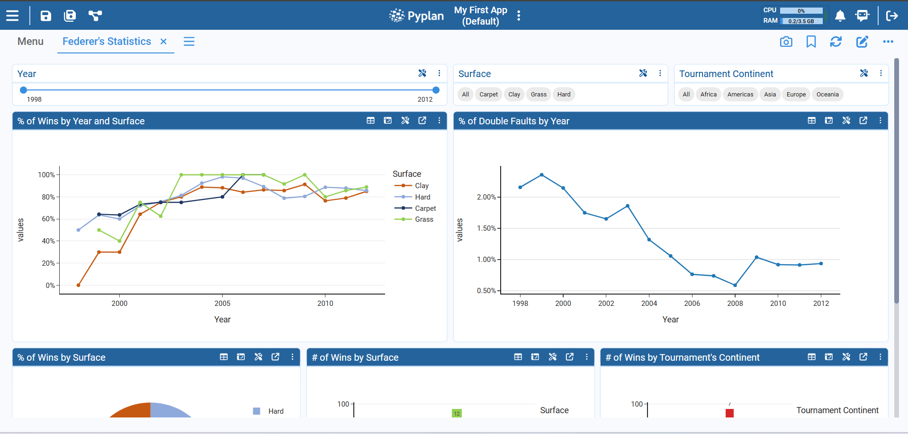
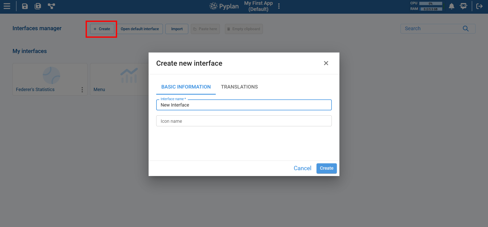
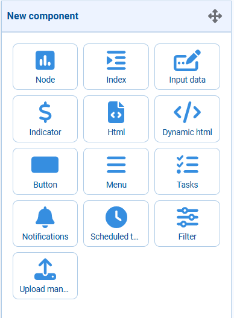
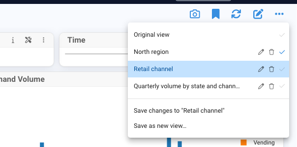
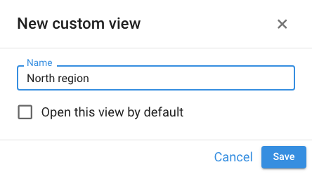
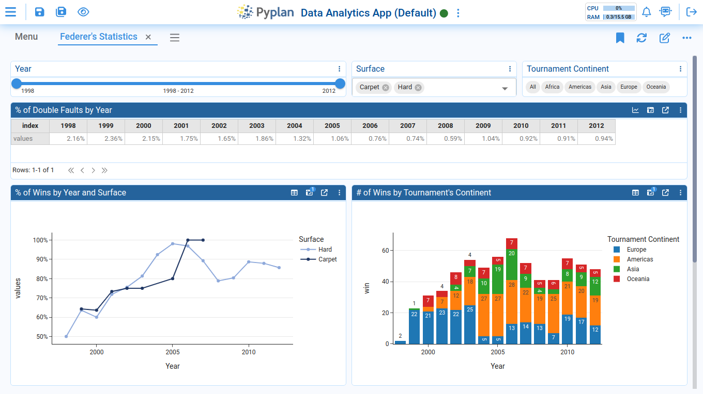

# Creating an Interface

Transform your data into actionable insights using user-friendly interfaces. Begin by clicking, and effortlessly tailor the experience to your needs. Easily visualize and comprehend your data without any complexity.

:::tip
This page describes **component interfaces**, built by assembling components on a grid. If you need a fully custom layout or tool, you can also build an [HTML interface](./html-interfaces.md) with Pyplan's AI agent.
:::

## Create an Interface

Begin by clicking on the **Create** button to initiate the process.

Next, personalize your interface by assigning a name and selecting an icon that best represents it. This step adds a touch of uniqueness to your analytics experience.

Dive into the design phase effortlessly. Click on the edit icon to start shaping your interface according to your preferences. This is where you get to tailor the visualization of your data exactly the way you want it.

## Components to Include in an Interface

Adding components to your interface opens up a world of possibilities for customization and functionality. Explore the diverse range of components available to tailor your interface to your specific needs.

## Custom Views of an Interface

Each user can save their own custom views of an interface. A custom view may include different components from the original interface, pre-applied filters, and its own arrangement of components within the interface grid. A user can keep several custom views of the same interface and switch between them.

Custom views are only visible to the user who created them. No write permissions on the application are required to create them.

### The custom views menu

Click the bookmark button on the interface toolbar to open the custom views menu. Its tooltip shows the view you are looking at, and the icon turns solid while a custom view is shown.

The menu lists the **Original view** (the interface as its author defined it) and each of your custom views. The view being shown is highlighted. Click a view to switch to it.

### Create a Custom View

Select **Save as new view…**, give the view a name and, if you want it to open whenever you open the application, check **Open this view by default**. The new view saves the interface as it is on screen and becomes the view shown.

While a custom view is shown, the changes you make to the interface grid — for example, changing a component from a chart to a table, switching a filter format to a selector, selecting specific values or moving components around — are saved into that view, never into the original interface:

### Choose the view that opens by default

The check on the right of each row marks the view that opens when you open the application. Click the check of another view to make it the default one, or the check of **Original view** to open the interface as defined. Only one view can be the default.

### Rename or delete a Custom View

Use the pencil icon of a view to rename it or change whether it opens by default, and the trash icon to delete it. Deleting the view being shown takes you back to the original view.

