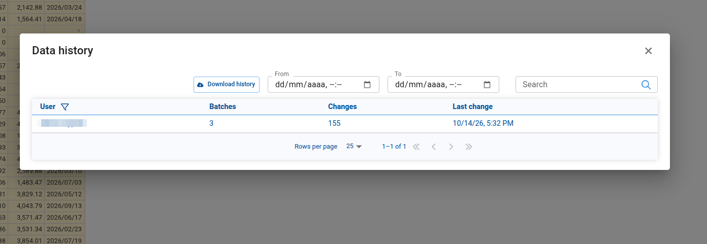
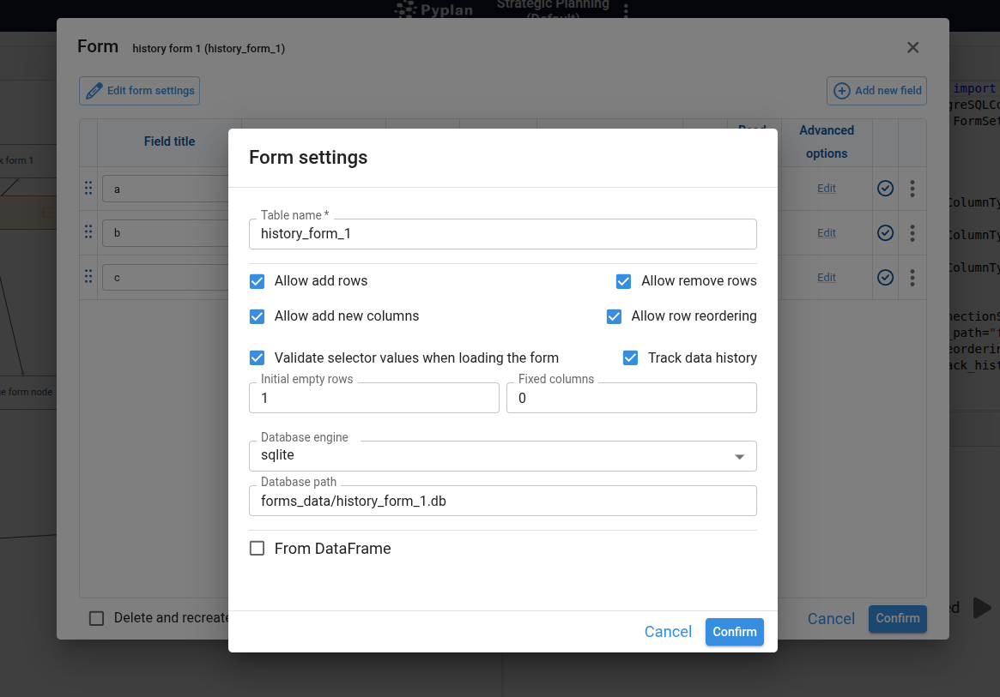
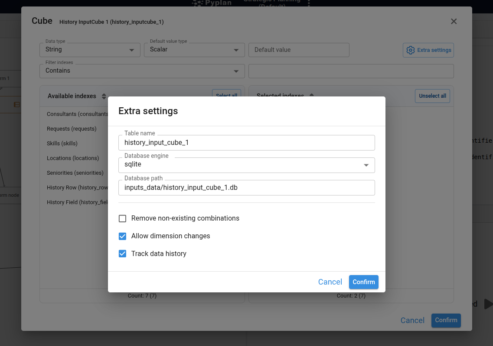
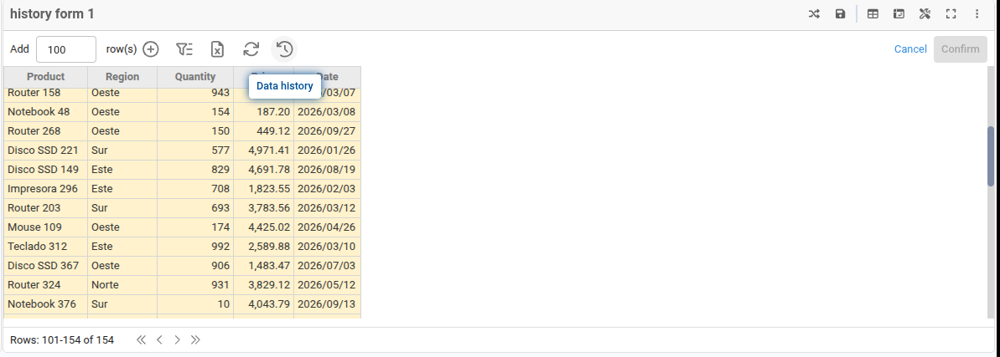
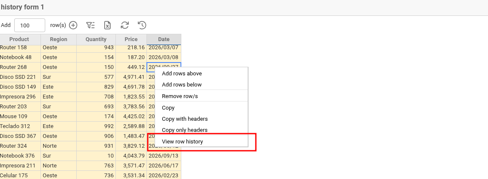
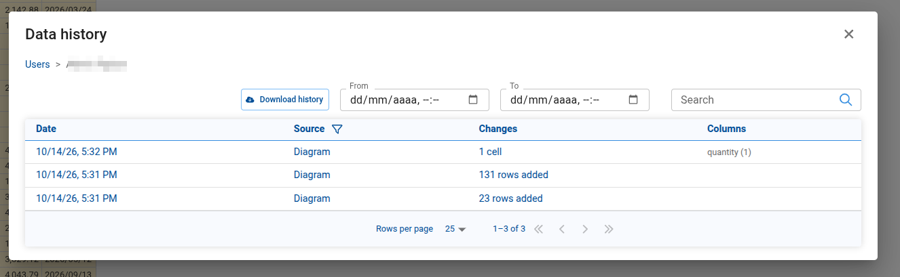
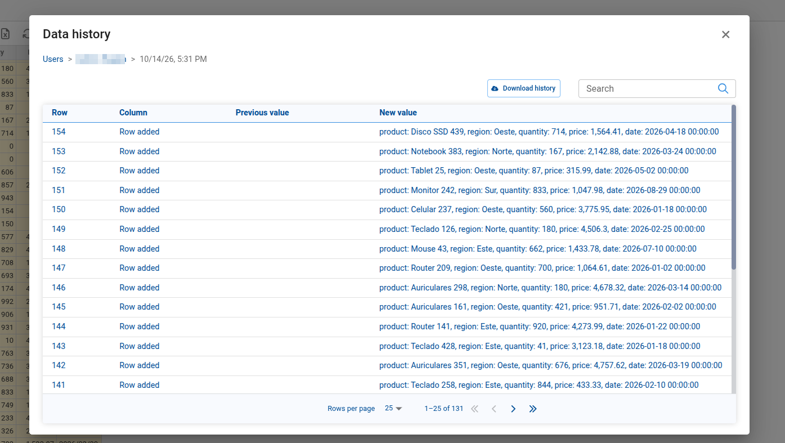
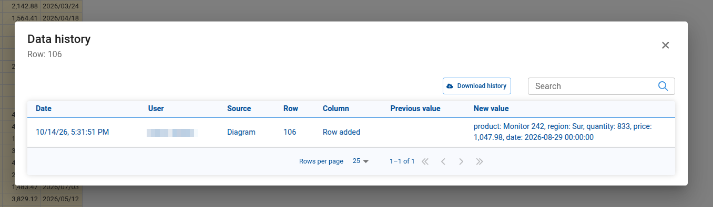
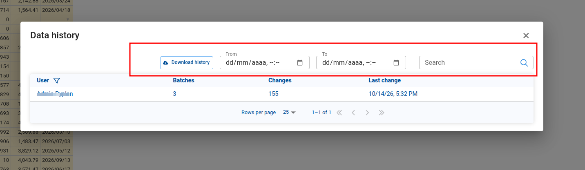
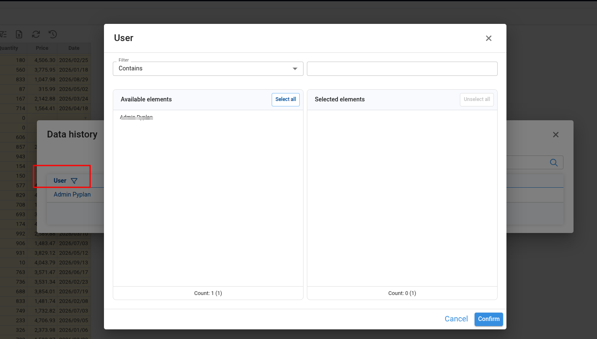

# Data History

Forms and Input Cubes can keep a **data history**: a read-only record of every confirmed change to their data. For each change it records who made it, when, from where, and the value before and after. Users can browse it from the interface, search and filter it, and download it as a CSV file, and the Pyplan Agent can answer questions about it.

The history cannot be edited or undone from the interface: it is an audit trail of what was confirmed.

---

## Turning It On

Data history is a setting of each Form and Input Cube.

- **New Forms and Input Cubes created with the wizard** have it turned on by default.
- **Existing ones** keep it off until it is turned on.

To change it, open the node's wizard and tick or untick **Track data history**. In a Form it is in the **Form settings** window; in an Input Cube, in the **Cube settings** dialog.

In code, it is the `track_history` setting of `FormSettings` and `InputCubeSettings` (see [Pyplan Functions](../code/pyplan-functions.md#formsettings)).

---

## What Is Recorded

Every time changes are confirmed, Pyplan records them in the same transaction as the data: either the data and its history are saved, or neither is.

| Change | What the history keeps |
|--------|------------------------|
| **A changed cell** | The row, the column, the previous value and the new value. |
| **An added row** (Forms) | The whole row, with the id the database gave it. |
| **A removed row** (Forms) | The whole row as it was before removing it. |
| **A changed cell of an Input Cube** | The combination of dimension members (for example `region: North, month: Jan`), the previous value and the new value. |

Each record also keeps:

- **User**: who confirmed the change.
- **Date and time**: when it was confirmed.
- **Source**: where it was confirmed.
- **App version**: the version of the application that was open.

| Source | Meaning |
|--------|---------|
| **Interface** | The Form or Input Cube in an interface. |
| **Diagram** | The node's result in the influence diagram. |
| **HTML interface** | An HTML interface. |
| **Agent** | The Pyplan Agent or an AI agent. |
| **Excel add-in** | The Pyplan add-in for Excel. |
| **Code** | Node code or a scheduled task that confirms changes. |

What is not recorded:

- **Pending edits**: only confirmed changes are recorded.
- **Reordering rows**: it does not change the data.
- **Rows the node creates on its own**: the combinations an Input Cube adds or removes when its dimensions change, and the rows a Form created from a DataFrame takes from its source. If a user types a value in one of those rows before confirming, that value is recorded as a changed cell.

**Previous value.** The previous value is the one the user saw when the data was loaded. If two users edit the same cell at the same time, both records show that same previous value, so it is clear that the second one overwrote a value they had not seen.

---

## Batches and Edit Sessions

Everything confirmed together is one **batch**. Pasting a block of cells from Excel and confirming it, for example, is one batch, however many cells it changes.

A Form or Input Cube with **Confirm on change** saves every edit as it is made, so editing by hand produces one batch per typed cell. To keep the list readable, consecutive single-change batches of the same user and source, less than five minutes apart, are shown together as an **edit session** (for example, "12 edits, 10:02–10:15"). A batch with more than one change is never merged into a session.

---

## Opening the History

**The whole history.** In a Form or Input Cube with data history, the toolbar shows a clock icon. Clicking it opens the **Data history** dialog. It works the same way in interfaces and in the node's result in the influence diagram.

**The history of one row.** In a Form, right-click a row and choose **View row history** to see only the changes of that row. It always opens the history of the row that was clicked, even when the table is sorted or paged.

---

## Browsing the History

The dialog shows one table at a time and is navigated level by level. A breadcrumb at the top shows where you are; click any of its levels to go back.

### Users

The first level lists the users who changed the data, with their number of **Batches**, their total number of **Changes** and their **Last change**. Click a user to see their batches.

### Batches

The batches of a user, newest first: the **Date** (or the time span of an edit session), the **Source**, a summary of the **Changes** (for example, "4,800 cells in 1,200 rows · 3 rows added") and the changed **Columns**. Click a batch or an edit session to see its changes.

### Changes

The changes of a batch or edit session: the **Row**, the **Column**, the **Previous value** and the **New value**. Added and removed rows show the whole row. In an Input Cube, the row is shown as its combination of dimension members.

### Row history

The history of a single row is a flat list with the date, user and source of each change.

All tables are paginated and show their total.

---

## Searching and Filtering

The toolbar of the dialog has a **Search** box, the **From** and **To** date-time filters, and the **Download history** button.

- **Search** looks for the text in the fields shown at the current level: the user names in the users level, the changed columns and the source in the batches level, and the row, column, values and operation ("Row added", "Row removed") in the changes. It ignores upper and lower case. Each level keeps its own search, so going back through the breadcrumb restores it. Dates are filtered with **From** and **To**, not searched.
- **From** and **To** take a date and a time, in your local time. **To** includes the minute you choose.
- **User** and **Source** filters, with several values at once, are in the headers of those columns. A source filter stays applied in the users level, where it is shown as a chip.

---

## Downloading the History

**Download history** downloads the changes of the current level, with its search and filters, as a CSV file.

---

## Asking the Pyplan Agent

The Pyplan Agent can read the history of the Form or Input Cube in the chat, or of any other one in the application. For example:

- "Who changed the Sales form today?"
- "What did user1 load yesterday afternoon?"
- "What was the price of Laptop before the last change?"

The agent can filter by a person's user name or full name, by date and time, and by source, and can search the changes. Agents connected through [Pyplan MCP](../mcp/overview.md) have the same tools.

---

## Where the History Is Stored

The history is stored in the same database as the data of the Form or Input Cube, in two tables:

- `<table_name>__history`: one record per change.
- `<table_name>__history_batches`: one summary per batch.

Some consequences:

- **Shared tables share their history.** Forms that use the same database and the same table name share their data, and therefore one history.
- **Versions copy the history.** Creating a new version copies its databases, so the new version starts with the history up to that moment and continues on its own.
- **The history outlives the data table.** Deleting the node or recreating its table keeps the history. A new Form with the same table name continues it.
- **PostgreSQL permissions.** With PostgreSQL, the history tables are created on the first confirmed change, so the database user needs permission to create tables.
- **No automatic cleanup.** The history grows with every confirmed change; it is never deleted automatically.
