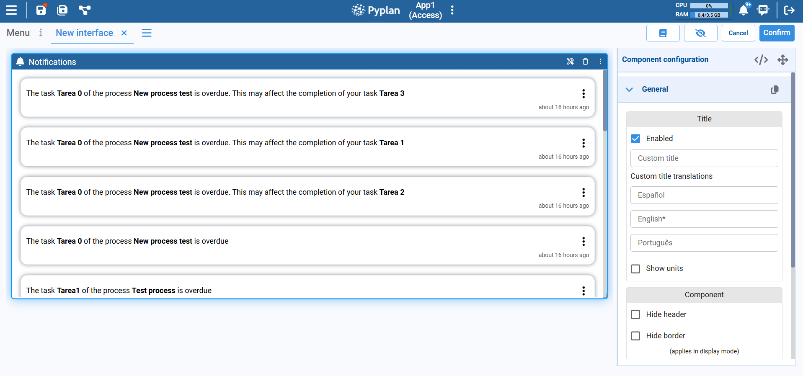

# Notifications Component

The Notifications component brings the notifications of the [bell](../../notifications-and-messages.md) into an interface: overdue tasks, process events, scheduled tasks, and the messages other users send us. It keeps the alerts related to our work next to the data they are about, so we can react quickly and stay aligned with the rest of the team.

Each notification shows:

- Who sent it or what generated it, and the message.
- The time it arrived, in our browser's time zone.
- A context menu, accessible via the ellipsis icon on the right, to mark the notification as read or unread, or to delete it.

The header of the component says which notifications it lists: **This app** or **All apps**. Opening a notification takes us where it points, the same as from the bell. Opening a message shows it in the bell, where we can read the whole conversation and reply. The **See all in the bell** link at the bottom opens the bell with every notification.

When we have permission to send messages, the **+** button in the header opens the **New message** dialog. See [Sending a Message](../../notifications-and-messages.md#sending-a-message).

## Options

In edit mode, the **Options** section of the component settings has these options:

- **Only this application**: checked by default. The component lists only the notifications of the open application. Unchecked, it lists those of every application, like the bell.
- **Allow writing messages**: checked by default. Unchecked, the component hides the **+** button, even for users who can send messages.

## Typical Usage

The Notifications component is commonly added to:

- A **home interface** or user dashboard, so each user immediately sees their most important alerts.
- A **process monitoring page**, where overdue tasks and critical events are highlighted.
- A **planning interface**, where the team exchanges messages about the data on screen, such as a figure that needs review.

By surfacing task events, process events, and messages in one place, the Notifications component improves communication and helps us respond to issues before they impact the rest of the workflow.
